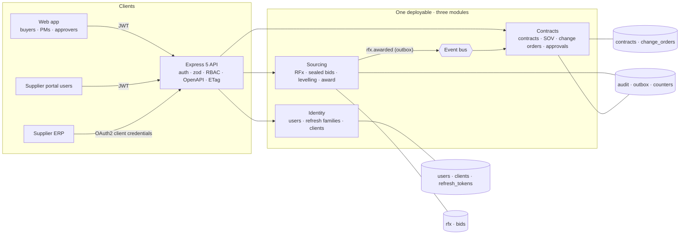
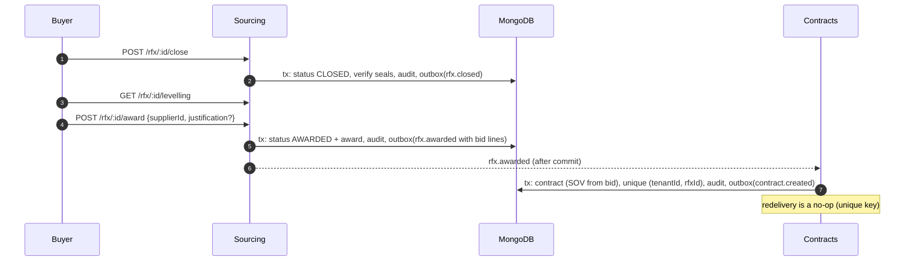
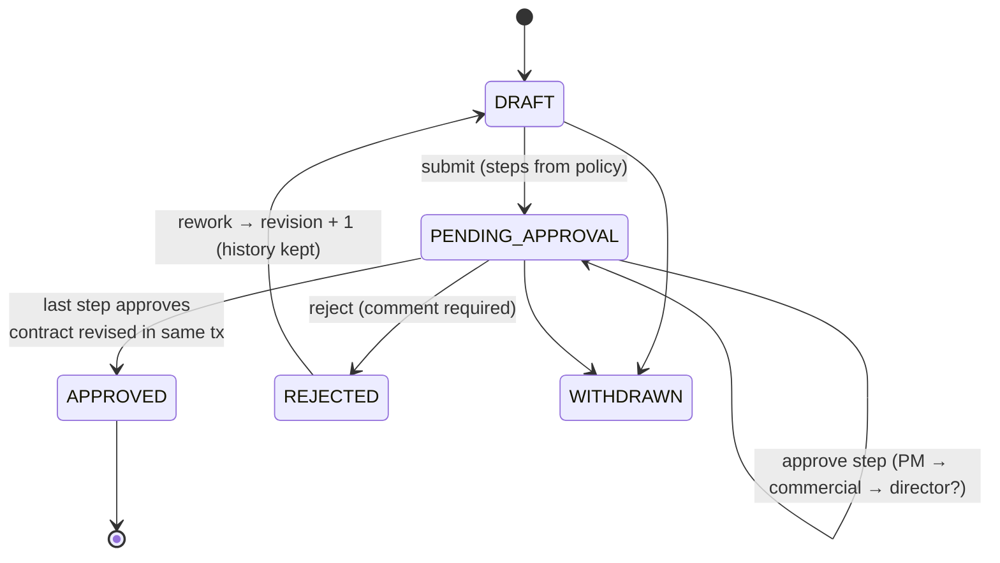

# Procurement & contracts PoC

**Live demo: https://procurement-contracts-poc.web.app** (static browser build, fictional data)

An independent proof of concept by Mohamed Abo Elmagd covering the source-to-contract lifecycle for
construction and capital projects: an **RFx sourcing event** (RFI / RFQ / RFP) with line items and
invited suppliers, **sealed bids**, a **bid levelling matrix**, **award**, a **contract** generated from
the winning bid's schedule of values, and **change orders** with live cost and schedule impact, a
multi-step approval workflow, contract versioning and an audit trail.
MERN + TypeScript: Express 5, MongoDB (Mongoose, multi-document transactions), React 19 with Zustand.
**All organisations, people and numbers are fictional.** Names are marked `(sample)`.

### About the live demo

Firebase Hosting is static, so the live site runs the **real domain services in your browser**:
`createInMemoryPlatform()` wires the sourcing and contracts modules to an in-memory unit of work with
the same semantics as the MongoDB adapter (buffered writes, version checks, unique keys, outbox).
Nothing is mocked or copied. Switch persona in the top-right corner. Things to try:

1. **Sourcing → RFQ-0001**: the opened bids and the levelling matrix. One supplier has the lowest raw
   total but skipped the post-tensioning line; levelling plugs the gap with the highest quote, so it
   drops to #2. Another supplier has a waterproofing rate flagged as an outlier.
2. **RFQ-0002** is open: switch to a **supplier** persona, price the lines and submit a sealed bid (you
   get a SHA-256 seal receipt). Back as the **buyer**, prices show as `sealed`. *Close bidding* verifies
   every seal, opens the bids and builds the matrix. Award; picking anything other than the
   recommended bid asks for a written justification.
3. **Contracts → CT-0001**: CO-002 is waiting for commercial approval. Approve as the commercial
   manager, then as the director (it needs director sign-off because it moves the programme by 18 days).
   The contract value, schedule of values, completion date and version history update in the same
   transaction. Try approving as the person who raised it, or rejecting without a comment.
4. **New change order** as the project manager: add and omit lines, change the markup, watch the
   totals, the revised contract value and the **approval route** update as you type.
5. **Events & audit**: the integration events (outbox) and the tenant audit log.

## What it covers

| Area | In this repo |
|---|---|
| TypeScript, design patterns | Aggregates with state machines (`Rfx`, `ChangeOrder`), ports & adapters (`UnitOfWork`, `Repository`, `IdentityStore`), Strategy (`ApprovalPolicy`), composition root (`platform.ts`), pure domain functions shared by API and UI |
| MongoDB / Mongoose | Document-per-aggregate schemas with validated integer money, compound + unique indexes, **multi-document transactions**, optimistic concurrency via `version`, outbox collection |
| Express REST APIs | Express 5, zod validation (field-level errors), consistent error model, `ETag`/`If-Match` (412/428), `x-request-id`, helmet, **OpenAPI 3.1** generated from the zod schemas + Swagger UI at `/docs` |
| Service boundaries | Modular monolith: identity, sourcing, contracts own their data and talk via events (`rfx.awarded` carries the bid lines). See [ADR-0001](docs/adr/0001-modular-monolith.md) |
| AuthN / AuthZ | JWT access tokens, rotating refresh tokens with reuse detection, **OAuth 2.0 client credentials** for supplier ERPs with scopes, role → permission matrix, tenant scoping, supplier data isolation, segregation of duties |
| Procurement domain | RFI/RFQ/RFP, invitations, sealed bids with tamper-evident seals, revisions until the deadline, early close only when everyone responded, levelling (plugs, outliers, spread, ranking), award justification |
| Contracts & change orders | Schedule of values, retention, add/omit lines against SOV, overhead & profit on adds only, schedule impact, delegation-of-authority approvals, reject → rework as a new revision, contract versions, audit trail |
| React + TypeScript frontend | Zustand store, data-dense tables (levelling matrix, SOV), change-order form with live totals and approval-route preview, approval timeline, persona switcher, supplier portal |
| Tests | **51 tests**: 34 backend unit, 11 API (supertest against a real MongoDB replica set via `mongodb-memory-server`), 6 React component tests (Testing Library) |
| Delivery | Dockerfile, docker-compose (MongoDB replica set + API), GitHub Actions on Node 24, Firebase Hosting demo |
| Team practices | [ENGINEERING_PLAYBOOK.md](ENGINEERING_PLAYBOOK.md) (branching, PR rules, review checklist, definition of done, AI-assistant rules), [ADRs](docs/adr), PR template |

## Architecture



### One award, end to end



### Change-order approval



## Design decisions

- **Money is integer minor units.** Quantities allow 3 decimals and are multiplied as integer
  thousandths with `BigInt`, then rounded once (half away from zero). `allocate()` splits lump sums
  exactly. The SOV invariant (`Σ lines = original + approved changes = revised value`, no negative
  lines) is asserted after every contract change.
- **Sealed bids.** Before closing, the API returns who responded and a SHA-256 seal of the canonical
  bid, never prices; the audit trail records the seal, not the amount. Closing re-computes every
  seal, so a bid edited in the database after submission shows as tampered and can't be awarded.
- **Levelling.** Each cell is unit × quantity. A missing line is plugged with the highest quote for
  that line (conservative), ranking uses the normalised total, quotes > 35% from the line median are
  flagged, and the recommendation is the cheapest *complete* bid.
- **Delegation of authority as a Strategy.** PM always reviews; commercial approves anything with a
  cost; the director approves if one CO is ≥ 5% of the original value, cumulative changes pass 10%, or
  the programme moves > 14 days. The form shows the route before you submit.
- **Segregation of duties.** The requester can't approve their own CO, and one person can't approve
  two steps even if they hold both roles.
- **Transactions + optimistic concurrency.** Multi-document changes run in a MongoDB transaction;
  every update is conditional on `version`. A lost race throws `ConcurrencyError` and the whole unit
  of work is retried with backoff, so two simultaneous approvals produce one approval and one 409. See
  [ADR-0002](docs/adr/0002-mongodb-consistency.md).
- **Outbox.** Events are inserted in the same transaction and published after commit; undelivered
  ones are relayed on boot. Handlers are idempotent.
- **Same rules everywhere.** The React form calls the same `computeTotals`, `validateDraft` and
  `ApprovalPolicy` as the API, so the live totals are exactly what the server will store.

## Run it

Requirements: Node.js 22+ (CI uses Node 24). Docker only for the compose setup.

```bash
npm run setup        # installs backend + frontend
npm test             # backend unit + API tests (downloads a MongoDB binary once), frontend component tests
npm run dev:api      # API on :3000 with in-memory adapters and demo data (no database needed)
npm run dev:web      # React demo on http://localhost:5173 (in-browser services)
```

### Docker (MongoDB replica set + API)

```bash
docker compose up --build   # mongo:8 as rs0, API on http://localhost:3000, docs at /docs
```

### Try the API with curl

Demo logins and clients are documented fixtures, not secrets. Password for every user: `demo-password-1`.
Users: `buyer@demo.test`, `pm@demo.test`, `commercial@demo.test`, `director@demo.test`,
`granite@supplier.test`, `riverside@supplier.test`, `summit@supplier.test`.

```bash
B=http://localhost:3000
TOKEN=$(curl -s -XPOST $B/auth/login -H 'content-type: application/json' \
  -d '{"email":"buyer@demo.test","password":"demo-password-1"}' | jq -r .access_token)
curl -s $B/api/v1/rfx -H "authorization: Bearer $TOKEN" | jq '.data[] | {number, status, title}'

# Supplier ERP: client credentials, then a sealed bid
CT=$(curl -s -XPOST $B/oauth/token -u summit-erp:summit-client-secret \
  -d grant_type=client_credentials -d 'scope=rfx:read bids:write' | jq -r .access_token)
curl -s $B/supplier/v1/rfx -H "authorization: Bearer $CT" | jq '.data[] | {id, number, lines: [.lines[] | {id, code}]}'
curl -s -XPUT $B/supplier/v1/rfx/<rfxId>/bid -H "authorization: Bearer $CT" -H 'content-type: application/json' \
  -d '{"lines":[{"lineId":"<lineId>","unitPriceMinor":4100}],"leadTimeDays":90,"validityDays":60}'
# → { "bidId": "...", "revision": 2, "sealHash": "9f2c…" }
```

### API surface

| Area | Endpoint | Notes |
|---|---|---|
| auth | `POST /auth/login`, `/auth/refresh`, `/auth/logout` | Access JWT 15 min; refresh rotated, reuse revokes the family |
| auth | `POST /oauth/token` | `grant_type=client_credentials`, Basic or body credentials, scopes |
| sourcing | `GET/POST /api/v1/rfx`, `GET /api/v1/rfx/:id` | Create RFI/RFQ/RFP with lines and invitations |
| sourcing | `POST /api/v1/rfx/:id/publish`, `/close`, `/award` | State machine; award creates the contract via `rfx.awarded` |
| sourcing | `GET /api/v1/rfx/:id/bids`, `/levelling` | Sealed summaries before close; matrix after |
| contracts | `GET /api/v1/contracts`, `/contracts/:id` | SOV, revisions, retention, dates |
| change orders | `GET/POST /api/v1/contracts/:id/change-orders` | Draft with lines, markup, schedule impact |
| change orders | `GET/PUT /api/v1/change-orders/:id` | `ETag` on GET; PUT requires `If-Match` (428/412) |
| change orders | `POST /api/v1/change-orders/:id/submit`, `/decision`, `/withdraw` | Approve/reject current step |
| audit | `GET /api/v1/audit/:entityId` | Per-entity trail |
| supplier API | `GET /supplier/v1/rfx`, `/rfx/:id`, `PUT /rfx/:id/bid` | Supplier users or client-credentials tokens only |
| meta | `GET /health`, `/openapi.json`, `/docs` | |

## Project layout

```
backend/src
  shared/       money, errors, actor + RBAC matrix, events, persistence ports, tx/outbox, retry, sequences
  identity/     AuthService (JWT, refresh rotation, client credentials), scrypt hashing, demo identities
  sourcing/     Rfx state machine, Bid + seal, levelling, SourcingService
  contracts/    Contract + SOV invariants, ChangeOrder, ApprovalPolicy, ContractsService
  infra/        memory/ (unit of work with commit-time checks) · mongo/ (schemas, transactions, identity store)
  http/         Express app, zod schemas, OpenAPI generator
  platform.ts   composition root (API, tests, browser demo)   seed.ts  fictional demo data via the services
backend/test    unit/ · api/ (supertest + mongodb-memory-server replica set)
frontend/src    React 19 + Zustand demo (imports backend/src domain code), components + component tests
docs/adr        architecture decision records
```

## Tradeoffs

- **Modular monolith instead of microservices.** One deployable and real transactions now; the
  outbox and event contracts make extraction a mechanical change later ([ADR-0001](docs/adr/0001-modular-monolith.md)).
- **Documents per aggregate.** Fast reads and atomic writes; very large contracts would need the SOV
  split into buckets, and reporting should use projections.
- **HS256 with a shared secret.** Fine for one service; production would use asymmetric keys with
  rotation (JWKS) or an external IdP.
- **Synchronous in-process event dispatch.** The award call returns once the contract exists, which
  keeps the UX simple; a broker would make it eventually consistent.
- **Single currency per sourcing event.** Multi-currency bids would need FX snapshots at bid time.

## What production would add

1. OIDC SSO for staff, supplier onboarding and invitations by email, MFA, login rate limiting.
2. Clarifications/Q&A and addenda during bidding, technical + commercial weighted scoring for RFPs,
   attachments (drawings, BOQs) with virus scanning and signed URLs.
3. Envelope encryption of sealed bids (KMS) so even DBAs can't read prices before opening.
4. Payment applications against the SOV (progress claims, retention release), budgets and commitments.
5. Configurable approval matrices per project and value band, delegation when approvers are away, SLAs and reminders.
6. Observability: OpenTelemetry traces, outbox lag alerts, audit export to immutable storage.
7. Load tests on bid submission around deadlines; contract tests for the event schemas.

## License

MIT © 2026 Mohamed Abo Elmagd
